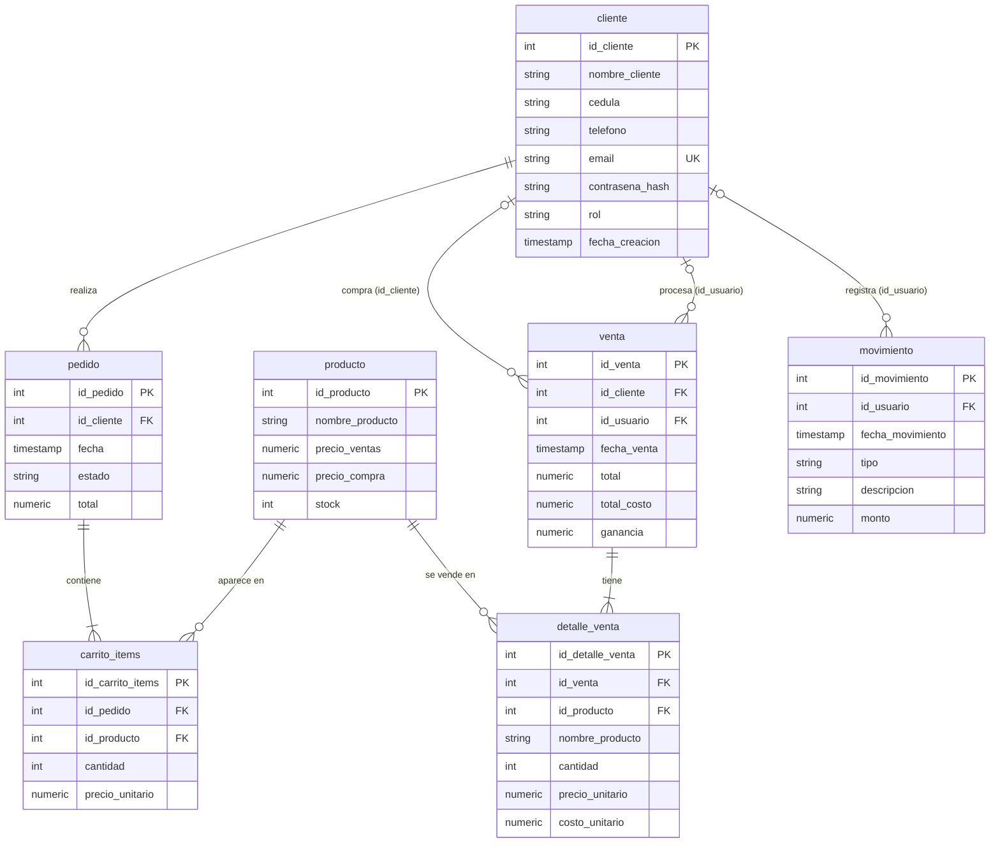

# Modelo relacional – Tienda Don Julio

Las tablas se crean con `database/init/01-schema.sql` y se cargan con `database/init/02-seed.sql`
(se ejecutan solas la primera vez que arranca el contenedor de PostgreSQL con el volumen vacío).
El diagrama `BD_Tienda.drawio.png` debe actualizarse para reflejar los cambios de abajo.

## Diagrama



(GitHub dibuja este diagrama automáticamente. El archivo `BD_Tienda.drawio.png` es la versión anterior y debe volver a exportarse.)

## Tablas

| Tabla | Clave primaria | Columnas principales | Llaves foráneas |
|---|---|---|---|
| `cliente` | `id_cliente` | `nombre_cliente`, `cedula` (única salvo el relleno `00000000`), `telefono`, `email` (único), `contrasena_hash`, `rol` (Cliente \| Trabajador), `fecha_creacion` | – |
| `producto` | `id_producto` | `nombre_producto`, `precio_ventas`, `precio_compra`, `stock` (≥ 0) | – |
| `pedido` | `id_pedido` | `fecha`, `estado` (Pendiente \| EnProceso \| Completado \| Cancelado), `total` | `id_cliente` → `cliente` |
| `carrito_items` | `id_carrito_items` | `cantidad`, `precio_unitario` (precio al crear el pedido) | `id_pedido` → `pedido`, `id_producto` → `producto` |
| `venta` | `id_venta` | `fecha_venta`, `total`, `total_costo`, `ganancia` | `id_cliente` → `cliente` (comprador, vacío en venta de mostrador), `id_usuario` → `cliente` (trabajador que la procesó, opcional) |
| `detalle_venta` | `id_detalle_venta` | `nombre_producto`, `cantidad`, `precio_unitario`, `costo_unitario` | `id_venta` → `venta`, `id_producto` → `producto` |
| `movimiento` | `id_movimiento` | `fecha_movimiento`, `tipo` (Ingreso \| Gasto \| CompraInventario), `descripcion`, `monto` | `id_usuario` → `cliente` (opcional) |

## Cambios respecto al diagrama anterior

1. **Se elimina la tabla `Usuario`.** `cliente` es la única tabla de cuentas y ahora guarda `contrasena_hash` y `rol`.
   Los antiguos `id_usuario` de `venta` y `movimiento` apuntan a `cliente`.
2. Las llaves foráneas ahora también existen en el código: `Order.ClienteId`, `Sale.ClienteId`, `Sale.UsuarioId`, `CashMovement.UsuarioId`.
3. `carrito_items` guarda `precio_unitario` y `detalle_venta` tiene `id_detalle_venta` e `id_venta` explícitos y guarda `nombre_producto` (copia del nombre al vender).
4. Se agregan restricciones: stock no negativo, cantidades positivas, estados/tipos/roles válidos, cédula y correo únicos.
5. Nombres en minúsculas, sin tildes ni ñ (`contrasena_hash`), para no usar comillas en SQL.

## Relaciones

- Un `cliente` tiene muchos `pedido`; un `pedido` tiene muchos `carrito_items`.
- Una `venta` tiene muchos `detalle_venta`; cada `producto` aparece en muchos `carrito_items` y `detalle_venta`.
- Una cuenta (`cliente` con rol Trabajador) puede procesar muchas `venta` y registrar muchos `movimiento`.

## Reglas del ciclo de vida (decisión 2 del sprint 4)

El pedido nace `Pendiente` sin tocar inventario ni caja. Cuando el trabajador lo confirma (`SaleService.ConfirmOrderAndCreateSaleAsync`),
en **una sola transacción** se valida y descuenta el stock, se crea la `venta` con sus `detalle_venta`, se registra el `movimiento` de tipo `Ingreso`
y el pedido pasa a `Completado`. `EnProceso` y `Cancelado` no mueven inventario ni caja.

## Cómo reiniciar la base

```cmd
cd Docker
docker compose down -v
docker compose up --build
```
`-v` borra el volumen; sin eso, Postgres no vuelve a ejecutar los scripts de `database/init/`.
